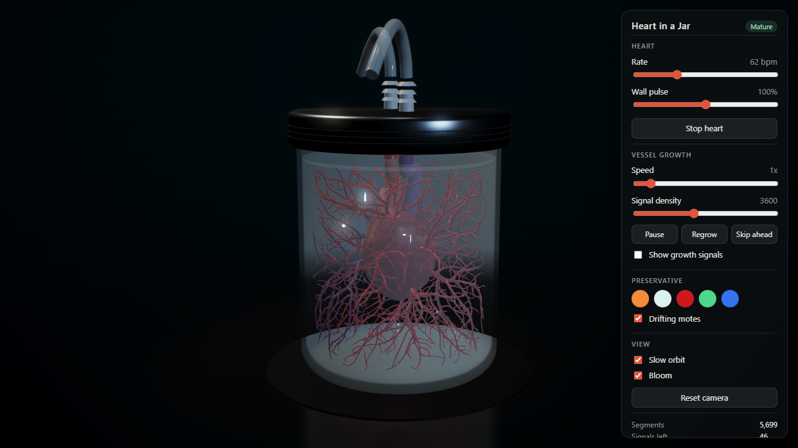

# Heart in a Jar

A beating heart suspended in a laboratory specimen jar of clear preservative. Blood vessels sprout from the heart and grow outward through the liquid using a space colonization algorithm, pulsing in time with each beat.



## Vessels growing

https://github.com/idiovoidi/Heart_In_A_Jar/raw/main/Docs/media/vessels-growing.webm

[Watch the vessel growth (webm)](Docs/media/vessels-growing.webm)

## Features

- Procedurally sculpted heart with a lub-dub beat (30-140 bpm).
- Space-colonization vessel growth with Murray's-law radius tapering; arterial red, venous purple.
- A pressure wave travels outward from the heart and swells the vessel walls.
- Click the glass to inject growth factor and trigger new branching.
- Selectable preservative colour (amber, clear, red, green, blue), drifting motes, bloom, slow orbit.

## Run

```sh
npm install
npm run dev
```

Built with Babylon.js 7, TypeScript and Vite. See [SPEC.md](SPEC.md) and [Docs/ARCHITECTURE.md](Docs/ARCHITECTURE.md).
